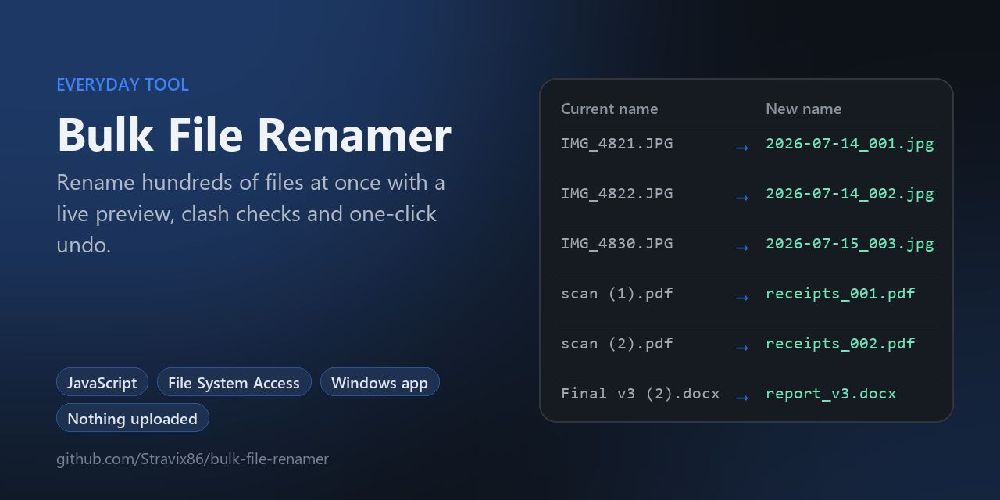
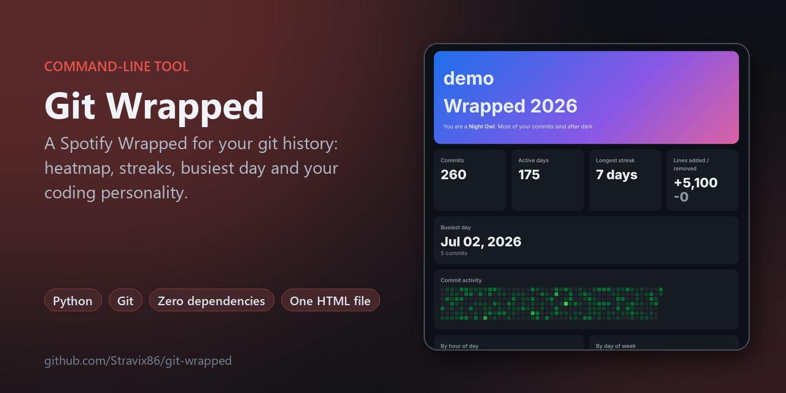

### Ade

Developer based in Ontario, Canada. I work on web apps and small desktop and mobile utilities, mostly in TypeScript and JavaScript. Background in IT and networking.

[X](https://x.com/stravix86) · [TikTok](https://www.tiktok.com/@stravix86) · [Chess.com](https://www.chess.com/member/strav1k) · [Lichess](https://lichess.org/@/Stravik)

---

#### Chess Mangrove

A web and Android app for running a team chess league: live boards, standings, predictions, fantasy and training tools. Built with React, TypeScript, Firebase and Stockfish compiled to WebAssembly.

[Live site](https://chess-mangrove-sports.vercel.app) · [Android APK](https://github.com/Stravix86/chess-mangrove-showcase/releases/latest/download/ChessMangrove.apk) · [Details](https://github.com/Stravix86/chess-mangrove-showcase)

#### Utilities

All open source. No accounts, no tracking; data stays on your device.

<table>
<tr>
<td width="50%" valign="top">

<b><a href="https://github.com/Stravix86/subscription-tracker">Subscription Tracker</a></b> 
Tracks recurring payments and free trials, with renewal reminders and calendar export. 
<a href="https://stravix86.github.io/subscription-tracker/">Web</a> · <a href="https://github.com/Stravix86/subscription-tracker/releases/latest/download/SubscriptionTracker-windows.exe">Windows</a> · <a href="https://github.com/Stravix86/subscription-tracker/releases/latest/download/SubscriptionTracker-android.apk">Android</a>
</td>
<td width="50%" valign="top">

<b><a href="https://github.com/Stravix86/bulk-file-renamer">Bulk File Renamer</a></b> 
Renames many files at once, with a preview, conflict checks and undo. 
<a href="https://stravix86.github.io/bulk-file-renamer/">Web</a> · <a href="https://github.com/Stravix86/bulk-file-renamer/releases/latest/download/BulkFileRenamer-windows.exe">Windows</a>
</td>
</tr>
<tr>
<td width="50%" valign="top">

<b><a href="https://github.com/Stravix86/lichess-chesscom-pieces">Lichess Chess.com Pieces</a></b> 
Browser extension that applies Chess.com piece sets to Lichess boards. 
<a href="https://github.com/Stravix86/lichess-chesscom-pieces/releases/latest/download/lichess-chesscom-pieces.zip">Download</a> · <a href="https://github.com/Stravix86/lichess-chesscom-pieces#install">Install guide</a>
</td>
<td width="50%" valign="top">

<b><a href="https://github.com/Stravix86/git-wrapped">Git Wrapped</a></b> 
Command-line tool that summarizes a repository's commit history as an HTML report. 
<a href="https://github.com/Stravix86/git-wrapped#usage">Usage</a>
</td>
</tr>
</table>

#### Tools

React, TypeScript, JavaScript, Python, Firebase, Tauri, Android, GitHub Actions, Vercel
