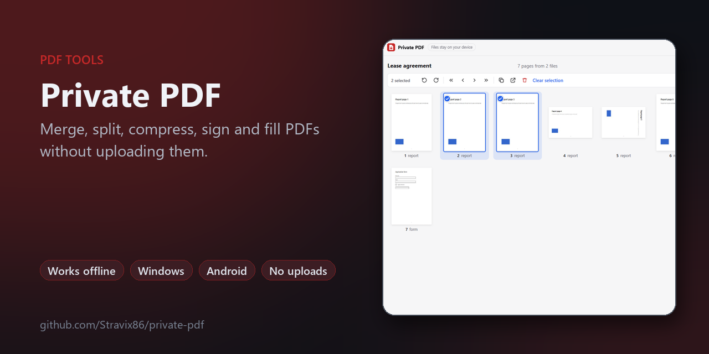
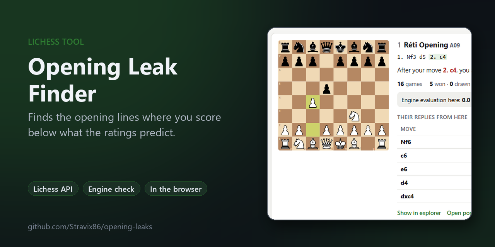
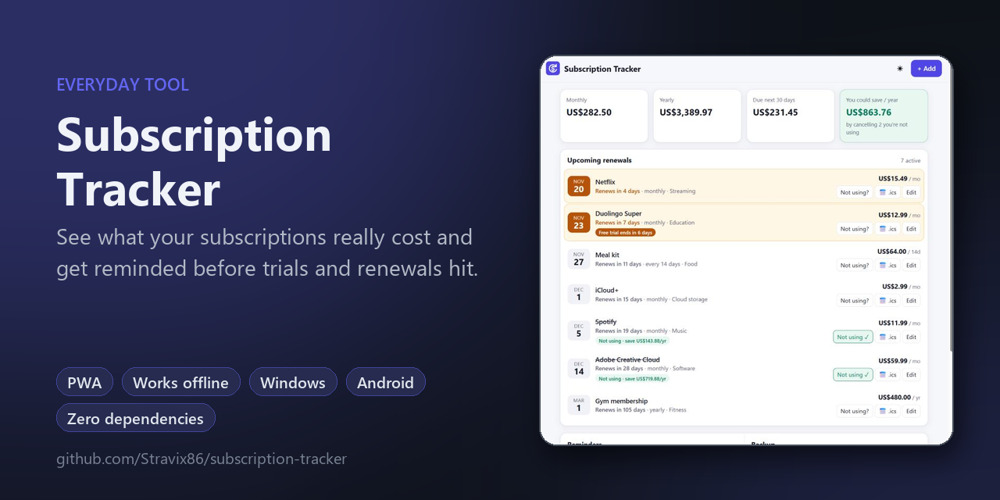

  
  
  
  

I'm into IT, networking, linux and chess. Sometimes I build web apps and small desktop and mobile tools, mostly around things I use myself, and a lot of them end up being about chess.

#### Chess Mangrove

A web and Android app for running a team chess league: live boards, standings, predictions, fantasy and training tools. Built with React, TypeScript, Firebase and Stockfish compiled to WebAssembly.

[Live site](https://chess-mangrove-sports.vercel.app) · [Android APK](https://github.com/Stravix86/chess-mangrove-showcase/releases/latest/download/ChessMangrove.apk) · [Details](https://github.com/Stravix86/chess-mangrove-showcase)

#### Private PDF

A PDF toolkit that runs on your device: merge, split, compress, sign, fill forms, add page numbers and convert to and from images. Files are never uploaded, and it works offline.

[Web](https://stravix86.github.io/private-pdf/) · [Windows](https://github.com/Stravix86/private-pdf/releases/latest/download/PrivatePDF-windows.exe) · [Android](https://github.com/Stravix86/private-pdf/releases/latest/download/PrivatePDF-android.apk) · [Source](https://github.com/Stravix86/private-pdf)

#### Opening Leak Finder

Analyses a player's Lichess games and finds the opening lines where they score below what the ratings predict, with engine checks from the Lichess cloud evaluation database and a repertoire explorer.

[Web](https://stravix86.github.io/opening-leaks/) · [Example](https://stravix86.github.io/opening-leaks/?user=Stravik) · [Source](https://github.com/Stravix86/opening-leaks)

#### Utilities

All open source. No accounts, no tracking; data stays on your device.

<table>
<tr>
<td width="50%" valign="top">

<b><a href="https://github.com/Stravix86/subscription-tracker">Subscription Tracker</a></b> 
Tracks recurring payments and free trials, with renewal reminders and calendar export. 
<a href="https://stravix86.github.io/subscription-tracker/">Web</a> · <a href="https://github.com/Stravix86/subscription-tracker/releases/latest/download/SubscriptionTracker-windows.exe">Windows</a> · <a href="https://github.com/Stravix86/subscription-tracker/releases/latest/download/SubscriptionTracker-android.apk">Android</a>
</td>
<td width="50%" valign="top">

<b><a href="https://github.com/Stravix86/bulk-file-renamer">Bulk File Renamer</a></b> 
Renames many files at once, with a preview, conflict checks and undo. 
<a href="https://stravix86.github.io/bulk-file-renamer/">Web</a> · <a href="https://github.com/Stravix86/bulk-file-renamer/releases/latest/download/BulkFileRenamer-windows.exe">Windows</a>
</td>
</tr>
<tr>
<td width="50%" valign="top">

<b><a href="https://github.com/Stravix86/lichess-chesscom-pieces">Lichess Chess.com Pieces</a></b> 
Browser extension that applies Chess.com piece sets to Lichess boards. 
<a href="https://github.com/Stravix86/lichess-chesscom-pieces/releases/latest/download/lichess-chesscom-pieces.zip">Download</a> · <a href="https://github.com/Stravix86/lichess-chesscom-pieces#install">Install guide</a>
</td>
<td width="50%" valign="top">

<b><a href="https://github.com/Stravix86/git-wrapped">Git Wrapped</a></b> 
Command-line tool that summarizes a repository's commit history as an HTML report. 
<a href="https://github.com/Stravix86/git-wrapped#usage">Usage</a>
</td>
</tr>
</table>

Current ratings, updated live from Lichess and Chess.com:

  
  
  
  

